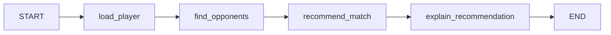
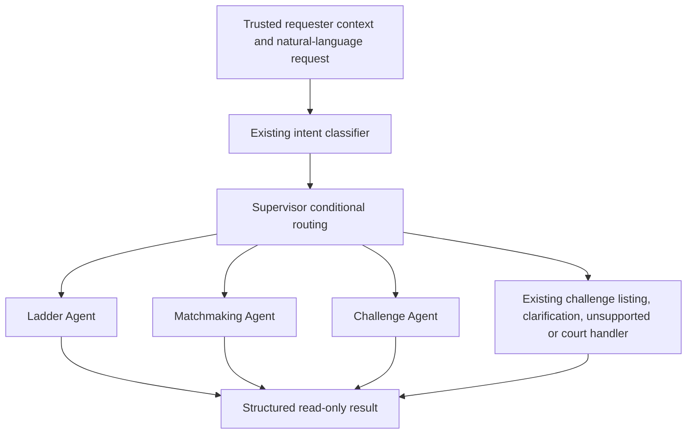
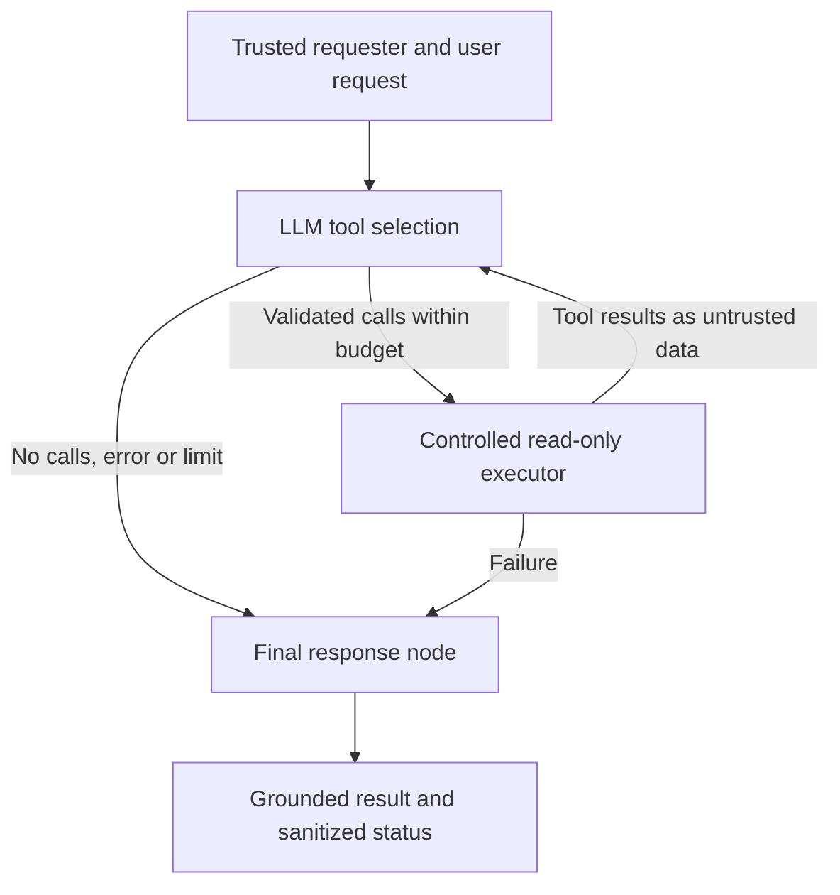

# RallyBot

RallyBot is an AI-powered tennis ladder and court dispatcher, developed
incrementally. This initial skeleton provides an installable Python package and
a console command that prints an initialization message, plus typed environment
configuration using Pydantic Settings.

## Requirements

- Python 3.14 or newer, available as `python` in PowerShell.

## Install and run (Windows PowerShell)

From the project root:

```powershell
python -m venv .venv
.\.venv\Scripts\python.exe -m pip install --editable .
.\.venv\Scripts\Activate.ps1
rallybot
```

Expected output:

```text
RallyBot initialized successfully!
```

If PowerShell blocks the activation script, run the installed command directly:

```powershell
.\.venv\Scripts\rallybot.exe
```

Verify the installed package can be imported:

```powershell
.\.venv\Scripts\python.exe -c "import rallybot; print(rallybot.__file__)"
```

The project uses a `src` layout and setuptools packaging configured in
`pyproject.toml`. Editable installation makes changes under `src/rallybot`
available without reinstalling the package.

## Configuration

From the project root, copy the sample configuration if you do not already have
a `.env` file:

```powershell
Copy-Item .env.example .env
```

Edit `.env` with your local values. Pydantic Settings reads the UTF-8 `.env` file
from the current working directory when present; a missing file is allowed.
Uppercase environment variables such as `APP_ENV` and `LOG_LEVEL` override
values in `.env`, which override defaults in `Settings`. Variable names are
case-insensitive, while allowed values for `APP_ENV` and `LOG_LEVEL` are
case-sensitive. Unknown `.env` keys are ignored.

For example, set a process environment override in PowerShell:

```powershell
$env:APP_ENV = "production"
```

Defaults and allowed values are documented in `.env.example`. The Ollama URL
is a plain URL (`http://localhost:11434`). The Discord token is optional and
defaults to `None` when omitted. It uses `SecretStr`, which masks the value in
normal string representations and JSON serialization. Do not explicitly extract
and print the token or log raw environment variables. `.env` is ignored by Git;
`.env.example` contains no real secrets and remains tracked.

Application code can load validated, immutable configuration with:

```python
from rallybot.config import get_settings

settings = get_settings()
```

`get_settings()` caches its first result. Restart the process after changing
configuration, or call `get_settings.cache_clear()` before reloading. Invalid
environment or log-level values raise a Pydantic `ValidationError` when settings
are loaded. The CLI continues to print only its original initialization message.
Plain startup creates no database connections or external service clients.

## Run tests (Windows PowerShell)

Install the updated project and its test dependencies, then run pytest:

```powershell
.\.venv\Scripts\python.exe -m pip install --editable ".[test]"
.\.venv\Scripts\python.exe -m pytest
.\.venv\Scripts\rallybot.exe
```

Tests use a temporary working directory, remove settings environment variables,
and clear the settings cache before and after each test. They do not read your
local `.env` file.

Pytest is configured in `pyproject.toml` to use the project-local `.pytest_tmp`
directory instead of the Windows system temporary directory. Run normally:

```powershell
.\.venv\Scripts\python.exe -m pytest -v
```

`.pytest_tmp/` and `.pytest_cache/` are ignored by Git. Pytest clears
`.pytest_tmp` before each run; keep it dedicated to test temporary files.

## Structured logging

The CLI reads `LOG_LEVEL` through Pydantic Settings and explicitly calls
`configure_logging()`. Importing the logging module does not configure handlers.
Logging uses Python's standard library and configures only the `rallybot`
namespace. Repeated configuration replaces the application-owned stderr handler
instead of adding duplicates. Root and unrelated third-party loggers are unchanged.

Set the level in `.env`, or override it in PowerShell:

```powershell
$env:LOG_LEVEL = "DEBUG"
rallybot
$env:LOG_LEVEL = "WARNING"
rallybot
```

Allowed levels are `DEBUG`, `INFO`, `WARNING`, `ERROR`, and `CRITICAL`; the default
is `INFO`. Records below the configured level are omitted. The initialization
message remains on stdout. Application logs go to stderr, with one JSON object
per line. Startup configures logging without emitting a log entry.

Use a logger in the package namespace and supply safe identifiers through `extra`:

```python
import logging

logger = logging.getLogger("rallybot.dispatcher")
logger.info(
    "Request received",
    extra={"request_id": "request-123", "agent": "dispatcher", "workflow_id": "workflow-456"},
)
```

Example stderr output:

```json
{"timestamp": "2026-10-24T12:00:00+00:00", "level": "INFO", "logger": "rallybot.dispatcher", "message": "Request received", "request_id": "request-123", "agent": "dispatcher", "workflow_id": "workflow-456"}
```

Timestamps are ISO 8601 in UTC. Only `request_id`, `agent`, and `workflow_id`
are included from `extra`; other context keys are ignored. Context values must
be JSON scalar values; arbitrary objects are replaced with `[REDACTED]` without
calling their string representations. Python logging rejects attempts to replace
reserved LogRecord attributes (such as `message`, `name`, or `levelname`) with a
`KeyError`. Context cannot overwrite the JSON envelope fields.

Use fixed, credential-free event messages. Never log Discord tokens, passwords,
API keys, environment variable contents, or complete Settings objects. Keep
credentials out of messages, interpolation arguments, and context identifiers.
`SecretStr` masking is not a substitute for this discipline.

For `logger.exception("Operation failed")`, the JSON includes an `exception`
object with the exception type only. Raw exception messages, exception chains,
tracebacks, and stack information are omitted because they may contain
credentials. Formatting failures produce a fixed safe JSON message without the
original record, its arguments, or the formatting exception.

Arbitrary user-provided strings and exception tracebacks cannot be guaranteed
secret-free without upstream sanitization. This formatter does not automatically
detect credentials embedded in strings. Sanitize inputs before logging them;
do not forward raw third-party errors or tracebacks to another handler.

## SQLite database foundation

RallyBot uses Python's built-in `sqlite3` module. No database server or additional
dependency is required. Database operations are explicit; ordinary `rallybot`
startup continues to print its initialization message without opening a database.

Set `DATABASE_URL` in `.env` or the process environment. Supported examples:

```dotenv
# Relative to the process working directory (the default).
DATABASE_URL=sqlite:///./data/rallybot.db
# Windows absolute path; forward slashes are recommended.
DATABASE_URL=sqlite:///C:/RallyBot/data/rallybot.db
# POSIX absolute path on POSIX systems.
DATABASE_URL=sqlite:////var/lib/rallybot/rallybot.db
# Private in-memory database, primarily for tests.
DATABASE_URL=sqlite:///:memory:
```

Paths are literal paths after `sqlite:///`, resolved when opening a connection.
Windows absolute paths with backslashes are also accepted, as is
`sqlite:////C:/RallyBot/data/rallybot.db`. Drive-relative paths such as `C:foo.db`
are rejected. URI options, query strings, fragments, percent-encoded paths, and
other schemes are unsupported and rejected. Spaces can appear literally in paths.
Always use the same working directory for relative URLs, or use an absolute URL
to ensure every invocation targets the same file.

From the project root in Windows PowerShell:

```powershell
.\.venv\Scripts\rallybot.exe db-init
$LASTEXITCODE
.\.venv\Scripts\rallybot.exe db-check
$LASTEXITCODE
```

`db-init` creates missing parent directories and initializes a small internal
`_rallybot_metadata`, `players`, and `challenges` tables at schema version `3`. Existing
version `1` or `2` databases receive the additive schema; existing tables and
data are preserved. Repeated initialization is safe, and unknown schema versions
are rejected without a downgrade. `db-check` opens an existing database and executes `SELECT 1`;
it does not create a missing file or check business schema or full file integrity.
Successful commands exit with `0`; database failures exit with `1`; invalid CLI
arguments exit with `2`. Success messages go to stdout, structured application
logs go to stderr, and failures also include a fixed human-readable stderr message.
Paths, configured URLs, and raw database exceptions are not printed.

Use the connection context manager for application transactions:

```python
from rallybot.config import get_settings
from rallybot.database.connection import database_connection

with database_connection(get_settings().database_url) as connection:
    row = connection.execute("SELECT 1 AS healthy").fetchone()
    assert row["healthy"] == 1
```

Every connection enables and verifies `PRAGMA foreign_keys = ON` before beginning
a transaction. `sqlite3.Row` provides named column access. A five-second busy
timeout allows brief lock contention. The context manager commits successful
transactions, rolls back on exceptions (including commit failures), and closes
the connection in all cases. Direct callers of `connect_database()` must close
the returned connection themselves. Connections retain SQLite's default
same-thread restriction; create a separate connection in each thread.

Each `:memory:` connection owns a fresh private database, discarded when closed.
Consequently, in-memory initialization and a later health check do not share
schema or data. Keep the same connection open for tests that need shared state
within a transaction, or use a temporary file to test persistence.

For troubleshooting, confirm the working directory and `DATABASE_URL`, run
`db-init` before `db-check`, and check access to the configured parent directory.
A failed health check can also indicate an invalid URL, a corrupt database, or
filesystem permissions. Lock errors can occur when another writer holds a
transaction beyond the timeout; keep transactions short and close connections.
Avoid resetting permissions or deleting databases as a general troubleshooting
step. Back up important files before investigating corruption.

## Ollama connectivity

Install Ollama for Windows and start its desktop application. If the server is
not already running, start it from a separate PowerShell terminal:

```powershell
ollama serve
```

If the port is already in use, check whether the desktop application is already
serving Ollama rather than starting a second instance. List existing local models:

```powershell
ollama list
```

Configure an already installed model by its exact name and tag in `.env`:

```dotenv
OLLAMA_BASE_URL=http://localhost:11434
OLLAMA_MODEL=llama3.2
OLLAMA_TIMEOUT_SECONDS=5.0
```

Update the Python dependencies and run the health check:

```powershell
.\.venv\Scripts\python.exe -m pip install --editable ".[test]"
.\.venv\Scripts\rallybot.exe ollama-check
$LASTEXITCODE
.\.venv\Scripts\python.exe -m pytest -v
```

The command displays server reachability, configured model availability, and
installed model names. Exit code `0` means both server and model are available;
otherwise it returns `1`. Plain startup and database commands retain their existing
behavior. Useful, credential-free diagnostics are emitted as JSON logs to stderr.

The connectivity module uses HTTPX to call only Ollama's documented
[`GET /api/tags`](https://docs.ollama.com/api/tags) endpoint. It does not run
inference, download models, or invoke a generation endpoint. It strictly checks
that the response contains a `models` list of objects with nonempty model names;
malformed entries invalidate the entire discovery result. Unknown response fields
are ignored. Duplicate names are returned once, preserving their original order.
Model names must contain only letters, digits, dots, underscores, colons, slashes,
and hyphens; control characters and credential-bearing URLs are rejected.

An omitted tag is compared as `:latest`: `llama3.2` matches `llama3.2:latest`, but
does not match `llama3.2:1b`. Explicit tags must match exactly and names are
case-sensitive. Registry port numbers are not treated as model tags.

`check_ollama_health(settings)` returns `server_reachable`, `model_available`,
`configured_model`, `available_models`, `error_code`, and a safe `message`.
Reachability is confirmed when an HTTP response is received, including error
responses. On a transport error or timeout it remains false; a response from an
unrelated HTTP service is not proof of a valid Ollama API.

| Error code | Meaning and action |
| --- | --- |
| `SERVER_UNAVAILABLE` | Connection or transport failed. Check that Ollama is running, and check the host, port, and firewall. |
| `REQUEST_TIMEOUT` | An HTTP operation exceeded its timeout. Check responsiveness; increase the timeout only when appropriate. |
| `HTTP_ERROR` | The server returned a non-success status. Confirm the API address and access configuration. |
| `INVALID_RESPONSE` | JSON or the model list is malformed. Confirm the address points to Ollama. |
| `MODEL_MISSING` | Discovery succeeded, but the configured model/tag is not installed. Compare with `ollama list` and select an installed model. |
| `INVALID_CONFIGURATION` | The base URL or configured model name is unsupported. Correct the configuration. |

The timeout must be a positive finite number. HTTPX applies it to connect, read,
write, and connection-pool operations; it is not a total wall-clock deadline.
Clients are closed after every discovery attempt. Automatic redirects and
environment-derived proxy configuration are disabled. Base URLs must use HTTP(S)
and must not include embedded credentials, query strings, or fragments. A base
path is supported (for example, a local reverse proxy at `/ollama`).

Raw exceptions, response bodies, endpoints, credentials, and complete settings
are never printed by the health check. Displayed model identifiers are intended
to be non-secret: do not place secrets in model names. All automated Ollama tests
use mock transports and prohibit real network requests; no running server is
needed. This step provides local LLM connectivity infrastructure only.

## Unified application health

Run a read-only check of application configuration, SQLite connectivity, Ollama
reachability and configured model availability, and application logging:

```powershell
.\.venv\Scripts\rallybot.exe health
$LASTEXITCODE
```

Example output when the required components work but the model is missing:

```text
Application: RallyBot
Overall health: DEGRADED
Configuration: PASS - Settings loaded and validated.
Database: PASS - Database connection available.
Ollama server: PASS - Server reachable.
Configured model: FAIL - Configured model not installed.
Logging: PASS - Application logger configured.
```

| Overall status | Exit code | Meaning |
| --- | --- | --- |
| `HEALTHY` | `0` | Configuration, database, logging, and Ollama/model checks all pass. |
| `UNHEALTHY` | `1` | Configuration, database, or logging is unavailable or invalid. |
| `DEGRADED` | `2` | Required components pass, but Ollama or the configured model is unavailable. |

Component results use `PASS`, `FAIL`, or `SKIPPED`, independently of overall
status. Invalid settings produce a safe `UNHEALTHY` report; dependent checks are
skipped. Database or logging failures take precedence over AI availability.
Logging is required infrastructure, so an unconfigured or failed logger makes
the application unhealthy. The CLI configures logging once after settings load;
the coordinator checks its application-owned JSON handler without adding one.
An HTTP error or invalid model list can leave the server reachable while model
availability remains unverified and the overall result is degraded.

Application readiness is distinct from AI model availability: a valid configuration,
working database, and configured logger allow the required infrastructure to be
ready even when the AI capability is degraded. Health checking never creates a
database, changes schema, downloads a model, or invokes inference. A missing
database therefore reports `UNHEALTHY` until explicitly initialized.

For configuration failures, check allowed values in `.env.example`. For database
failures, verify `DATABASE_URL` and the working directory, then explicitly run
`rallybot db-init` if the intended database has not been created. Use
`rallybot db-check` to isolate database connectivity. For AI failures, use
`rallybot ollama-check` and `ollama list`, start Ollama if needed, and select an
installed model/tag. For logging failures, check that the application-owned
stderr handler is usable; health reporting does not reset unrelated loggers.
Reports show the configured application name as a public display label; keep
secrets out of it. URLs, tokens, full settings, raw errors, and response bodies
are omitted from the unified report and its structured diagnostics.

The service in `rallybot.health` accepts settings-loader, database-checker,
Ollama-checker, and logging-checker callables. Direct callers can inspect existing
logging without configuration; an optional logging-configurer callable supports
CLI setup. Tests inject deterministic checks to simulate outages and validation
errors without contacting a server or touching a production database.

## Secure Discord connection

Prerequisites: a Discord application with a bot account in the Developer Portal,
and that bot installed in your development server. Keep Message Content, Server
Members, and Presence privileged intents disabled. This step enables only the
non-privileged Guilds intent. The slash commands are `/ping`, `/ladder`, `/register`,
`/challenge`, `/accept`, `/decline`, and `/cancel-challenge`; no message
handlers are installed.

Add your bot token locally to the existing ignored `.env` file:

```dotenv
DISCORD_BOT_TOKEN=replace-with-your-private-bot-token
# Replace with your development server's numeric ID.
DISCORD_GUILD_ID=123456789012345678
```

Use the bot token from the application's Bot page, not an application ID, public
key, client secret, or a personal Discord account token. Do not include the
`Bot ` prefix. The existing `SecretStr` setting masks its normal representation;
only the connection call extracts the value. Environment variables override
`.env`, so a stale process-level token can override a corrected file.

From the project root in Windows PowerShell:

```powershell
.\.venv\Scripts\python.exe -m pip install --editable ".[test]"
.\.venv\Scripts\python.exe -m pytest -v
.\.venv\Scripts\rallybot.exe discord-start
```

The command announces startup and remains running while connected. At the default
`INFO` level, readiness emits a JSON log to stderr containing the numeric bot ID,
without usernames, tokens, server names, or complete settings. Readiness can occur
again after reconnection. The application adds no reconnect loop: discord.py
handles recoverable gateway disconnects with its own backoff. Unrecoverable
authentication, gateway, HTTP, or network failures produce sanitized messages
and exit code `1`. Missing or whitespace-only tokens fail before any login attempt.
The development guild ID is also required before login; it is never inferred and
there is no global synchronization fallback.

Press **Ctrl+C** once to stop. Async cancellation closes the client, gateway, and
HTTP session; the command logs shutdown and exits with `0`. Forcing termination
or interrupting cleanup repeatedly may prevent graceful shutdown. Event-handler
failures use a fixed safe log message instead of a raw exception traceback.
The connection uses `asyncio.run()` rather than `Client.run()`, so it does not
install discord.py's default logging handler or alter unrelated logger settings.

If authentication fails, confirm that the bot token is correct, has not been
revoked, and is not overridden by an old `DISCORD_BOT_TOKEN` environment variable.
Reset a compromised token in the Developer Portal and update the local value.
For connection failures, check Internet access, firewall/proxy restrictions, and
Discord service availability. Gateway intent failures should be investigated
without enabling privileged intents for this implementation.

Never commit `.env`, paste tokens into chat, print settings, or enable verbose
third-party HTTP/gateway logging that could expose credential-bearing data.
Restrict access to the local `.env` file and rotate any exposed token. Keep
`.env.example` free of real secrets. The automated tests use fake tokens and
mocked Discord operations; they do not require Internet access or a live bot.
Existing startup, database, Ollama, and unified health commands remain independent
of the Discord connection. Unified health does not attempt a Discord login.

## Development-guild /ping command

Enable Developer Mode in Discord's user settings, then use **Copy Server ID** on
your development server. Put that positive integer in `DISCORD_GUILD_ID` in `.env`.
The setting defaults to `None` for commands that do not start Discord. Do not use
a channel ID, bot ID, or application ID in place of the server ID. No guild ID is
hardcoded in application code. Environment variables override the `.env` value.

Start the bot from the project root:

```powershell
.\.venv\Scripts\python.exe -m pytest -v
.\.venv\Scripts\rallybot.exe discord-start
```

At the default `INFO` log level, look for command registration, development-guild
synchronization, and bot readiness JSON logs. In that server, select `/ping` from
the slash-command menu. RallyBot responds through the interaction response API:

```text
Pong!
```

Command registration lives in `discord_bot/commands.py`. After authentication,
discord.py calls the client's `setup_hook()` before opening the gateway. This
hook registers the supported slash commands locally and calls
`tree.sync(guild=development_guild)`.
Registration is idempotent, and a per-client flag prevents repeated successful
syncs. Reconnects and repeated `on_ready` events do not perform synchronization.
A new process creates a new client and synchronizes once for that startup.

Synchronization publishes this client's command set to the configured guild,
replacing that application's prior guild command set. It never syncs globally
or registers commands in other guilds. Missing `DISCORD_GUILD_ID` exits with a
clear configuration message before login. Invalid or nonpositive values fail
settings validation. Startup must be restarted after configuration changes.

If `/ping` is absent, confirm that the bot is installed in the configured server
with the `applications.commands` scope, that synchronization succeeded, and that
the invoking member can use application commands in that channel. Refresh the
Discord client if necessary. Synchronization permission or API failures stop
startup safely. Do not enable privileged intents to troubleshoot this command.

Invocation logs contain only a fixed event message, without user IDs, tokens, or
interaction payloads. Command errors also use a fixed safe log message. Tests
mock synchronization and interaction responses; no commands are published during
automated verification. Stop the bot with **Ctrl+C** as before.

## SQLite-backed tennis ladder

`/ladder` retrieves persisted players from the configured `DATABASE_URL`. Run
`db-init` explicitly before using it; startup, health checks, and ladder reads do
not initialize or seed a database. Back up important files before schema changes.
Initialization adds players and challenges to existing supported databases without
dropping tables or replacing data, and records schema version `3` atomically.

| Player column | Storage and constraints |
| --- | --- |
| `id` | Integer primary key. |
| `discord_user_id` | Optional text; unique when non-null. Multiple unlinked players are allowed. |
| `display_name` | Required nonblank text. Names are not unique. |
| `points` | Nonnegative integer, default `1000`. |
| `created_at` | UTC ISO 8601 timestamp, set on creation. |
| `updated_at` | UTC ISO 8601 timestamp, initially equal to creation time. No update operation is implemented yet. |

`PlayerRepository` provides typed `create_player()`, `get_player(id)`,
`list_players()`, and `list_rankings()` methods. SQLite rows remain inside the
repository; callers receive immutable `Player` or `PlayerRanking` dataclasses.
SQL parameters bind player values. Duplicate Discord identities raise
`DuplicateDiscordUserError` without overwriting the existing player. Every
operation uses the existing transaction context manager, including foreign keys,
commit/rollback, busy timeout, thread affinity, and explicit connection closure.

`get_ladder()` delegates to the repository and can receive an injected repository
for tests. Rankings sort by **points descending**, then **player ID ascending**
for deterministic ties. Ranks are consecutive positions (`1`, `2`, `3`), including
when points are equal. An initialized database without players returns an empty
ladder; it never falls back to hardcoded sample rankings.

### Development seeding

Use the optional seed command only with `APP_ENV=development`. It adds the five
development players: Alex Johnson (1200), Sam Wilson (1100), Chris Lee (1000),
Jordan Davis (900), and Taylor Brown (800). Their Discord IDs remain null.
It skips a sample whenever an exact, case-sensitive display-name match already
exists, preserving all existing names, identities, and points. Repeating the
command is idempotent. The seed runs in one transaction and acquires a write lock
before checking names. It is never run automatically.

From the project root in Windows PowerShell, using the intended development
database configured in `.env`:

```powershell
.\.venv\Scripts\python.exe -m pytest -v
.\.venv\Scripts\rallybot.exe db-init
.\.venv\Scripts\rallybot.exe ladder-seed
.\.venv\Scripts\rallybot.exe ladder-seed
.\.venv\Scripts\rallybot.exe db-check
.\.venv\Scripts\rallybot.exe discord-start
```

On an empty initialized database, the first seed reports `5 added, 0 skipped`;
the second reports `0 added, 5 skipped`. Seeding exits with `0` on success and
`1` for a database failure or any environment other than development. It requires
an already initialized database and will not create a missing one. The sample
data helper is used exclusively for explicit development seeding, not retrieval.

### Discord presentation and limitations

After restarting the bot and waiting for guild synchronization and readiness,
invoke `/ladder`. The existing embed now shows database rankings without a
development-sample label. An empty ladder responds with a friendly message.
The handler defers the interaction first, then runs the synchronous service in
`asyncio.to_thread()`. Connections are opened and closed within that worker,
keeping SQLite lock waits off the Discord event loop. It then edits the original
interaction response. Failures use a generic response and sanitized logs without
player identifiers, paths, or raw database exceptions.

For readability and Discord limits, the embed displays at most 25 leading
rankings and truncates long names to its field limit. A total character budget
may reduce that number further; a footer indicates when only part of the ladder
is shown. The repository still returns the full ordered ladder. Pagination,
score updates, scheduling, and reservations are
not implemented. There are no agents or model-generation calls.

`/ping` still responds `Pong!`; command synchronization remains guild-only and
runs once per startup. No new configuration, dependencies, or privileged intents
are required. Check channel Embed Links permissions if embeds cannot be shown.
Stop with **Ctrl+C**. Tests use isolated temporary databases and mocked Discord
interactions; they never modify the developer's configured database.

## Discord player registration

In the configured development server, use the required `name` option:

```text
/register name:Alex Johnson
```

Registration trims surrounding whitespace and requires 1–50 characters after
trimming. Empty, whitespace-only, and longer names receive:

```text
Please provide a valid name (1–50 characters).
```

The bot uses the invoking interaction's authenticated Discord user ID. There is
no user-ID option and no starting-points option. A successful registration creates
one linked player with 1000 points and responds privately:

```text
Registration successful! Welcome to RallyBot, Alex Johnson. Starting points: 1,000.
```

Repeated registration responds privately with the caller's stored name:

```text
You are already registered as Alex Johnson.
```

It does not rename that player or change points, timestamps, or rankings. The
registration service first checks for an existing identity, then relies on the
existing SQLite unique constraint during insertion. If concurrent requests race,
one insert succeeds and the other rolls back, retrieves the committed player
through a fresh connection, and returns the duplicate outcome. Connections are
never shared between threads. No schema migration is needed for this command.

The Discord handler immediately defers privately, runs registration in a worker
thread, and edits that private response. Mentions in names are not activated.
Database and unexpected errors receive only:

```text
Registration is temporarily unavailable. Please try again later.
```

Logs contain fixed invocation/error messages without player names, Discord user
IDs, tokens, interaction payloads, or raw database errors. Confirmation and
duplicate responses are ephemeral; the registered display name and points are
subsequently visible through the server's `/ladder` command. Seeded players are
preserved and are not automatically linked by matching names. Different Discord
users may use the same display name because identity uniqueness applies to
Discord user IDs, not names.

For local verification, configure the existing `.env` for your intended database,
bot token, and development guild, then run from the project root:

```powershell
.\.venv\Scripts\python.exe -m pytest -v
.\.venv\Scripts\rallybot.exe db-init
.\.venv\Scripts\rallybot.exe discord-start
```

After guild synchronization and readiness, invoke `/register name:Your Name`,
repeat it to check the private duplicate response, and invoke `/ladder` to see
the persisted player at 1000 points. `/ping` still returns `Pong!`. Stop with
**Ctrl+C**. Tests use temporary databases and mock all Discord operations.

Registration does not initialize or seed the database automatically. A missing
or uninitialized database produces the safe unavailable response until `db-init`
is run. Name changes, profile linking, registration on behalf of another user,
score updates, match scheduling, court management, agents, and model generation
are not implemented.

## Tennis challenge management

Two Discord users can create and resolve a challenge after both have registered:

```text
/challenge opponent:@Opponent
/accept challenge_id:1
/decline challenge_id:1
/cancel-challenge challenge_id:1
```

Select the opponent using Discord's member picker. The command accepts no player
ID or challenger identity. Every action identifies its caller using
`interaction.user.id` and looks up the associated player. Unlinked development
seed players cannot be targeted by Discord identity; users must register their
own profiles. Challenger and opponent must be different registered players.

| Action | Permitted actor | Required status | Result |
| --- | --- | --- | --- |
| `/challenge` | Registered challenger | No pending challenge for the pair | `PENDING` |
| `/accept` | Challenged opponent only | `PENDING` | `ACCEPTED` |
| `/decline` | Challenged opponent only | `PENDING` | `DECLINED` |
| `/cancel-challenge` | Original challenger only | `PENDING` | `CANCELLED` |

Accepted, declined, and cancelled challenges are terminal. A repeated or racing
action cannot change them again. Duplicate pending challenges are rejected even
if the players reverse roles. Only pending challenges block a new challenge;
a new pending challenge may be created after an earlier one leaves that state.

The `challenges` table stores integer `id`, foreign keys
`challenger_player_id` and `opponent_player_id`, validated `status`, and UTC
`created_at`/`updated_at` timestamps. Self-challenges are also rejected by a
database constraint. A unique partial expression index applies to the smaller
and larger player IDs only while status is `PENDING`, enforcing unordered-pair
uniqueness even under concurrent requests. Schema version `3` adds this table and
index transactionally without deleting existing player or challenge data.

The repository returns typed `Challenge` objects and provides creation, lookup,
per-player listing, and conditional status updates. Each transition is one
parameterized `UPDATE ... WHERE status = 'PENDING'` statement that also checks
the actor's permitted player role, returning the updated row. If acceptance and
decline race, one update succeeds; the other changes no row and returns a safe
validation failure. The service checks registration and authorization before the
write, while the write repeats the authorization guard atomically. No points or
rankings are updated by any challenge action.

Handlers defer privately before running the service in a worker thread. Validation
and unexpected errors remain ephemeral. On success, the bot completes the private
acknowledgment and posts a separate public confirmation, for example:

```text
Challenge #1 created. Status: PENDING.
Challenge #1 accepted. Status: ACCEPTED.
```

Public messages contain only the challenge ID, action, and status; they do not
mention members or expose internal player IDs, names, tokens, or interaction
payloads. If confirmation delivery fails after commit, the private response says
the action was saved and warns against repeating it. A response-delivery failure
does not roll back a saved challenge. Structured logs record fixed lifecycle
events, warning-level validation failures, and sanitized infrastructure errors.

To verify locally, stop the bot, back up important database files, and run from
the project root with the intended `.env` configuration:

```powershell
.\.venv\Scripts\python.exe -m pytest -v
.\.venv\Scripts\rallybot.exe db-init
.\.venv\Scripts\rallybot.exe discord-start
```

After synchronization and readiness, have two accounts run `/register` if needed.
Create a challenge and note its ID from the confirmation. As the opponent, accept
or decline it; on a separate pending challenge, verify challenger cancellation.
Try a duplicate pending challenge and an unauthorized action to verify private
errors. `/ping`, `/ladder`, and `/register` retain their existing behavior. Stop
with **Ctrl+C**. Automated tests use temporary databases and mocked Discord APIs;
they never publish commands or touch the configured development database.

Known limitations: challenge IDs come from confirmations; no challenge-listing
slash command, expiry, reminders, direct messages, match records, scores, court
scheduling, matchmaking recommendations, agents, or generation are implemented.
Challenge data uses the existing application database and is not partitioned by
guild. Initialization is explicit; health checks verify database connectivity,
not whether every application table has been initialized.

## Database-backed LangGraph matchmaking

The deterministic graph now retrieves real player records through a typed tool
layer. It still follows the same fixed sequence:



`tools/player_tools.py` exposes these reusable capabilities:

- `get_registered_player(player_id, repository)` retrieves a stored player or
  raises a safe `UnknownPlayerError` when that internal ID is unknown.
- `list_potential_opponents(player_id, repository)` returns other stored players
  with their existing ladder ranks, excluding the requester by ID.
- `filter_opponents(player, opponents)` applies the inclusive 200-point range and
  orders candidates by absolute point difference, ladder rank, then player ID.

Tool results contain internal ID, display name, points, and (for opponents) rank.
Discord user IDs and timestamps do not enter graph state or CLI output. A player
means a record in the players table, including explicitly seeded development
players; a Discord link is not required for this CLI workflow. Duplicate display
names are allowed and remain distinct by their primary keys.

The repository owns SQL, transaction handling, and connection cleanup. Its
`list_ranked_players()` query is reused by the existing ladder ranking method,
so ladder ordering remains points descending, then player ID ascending. Tools
provide focused read-only operations over that repository. Application services
coordinate business rules; graph nodes coordinate tool calls and state updates.
No SQL is duplicated in tools or nodes.

### State and execution

`MatchmakingState` retains player name, points, eligible opponents, recommendation,
and status, and adds `player_id` and `recommended_opponent_id`. Opponent dictionaries
carry `id`, `name`, `points`, and `rank`, so duplicate names are never identities.
Optional `explanation` and `explanation_source` fields hold explanatory text and
its source; they are cleared on each run.
Nodes return typed partial `MatchmakingUpdate` values:

1. `load_player` validates a positive integer ID, retrieves that player's database
   values, replaces caller-supplied name/points, clears stale results, and sets
   `PLAYER_LOADED`.
2. `find_opponents` calls the listing and filtering tools, writes the ordered
   eligible list, and sets `OPPONENTS_FOUND`. The requester is excluded by ID;
   equal display names do not exclude other players.
3. `recommend_match` performs no I/O. It selects the first ordered candidate and
   writes both the recommended ID and display name, with `MATCH_RECOMMENDED`.
   An empty eligible list produces `NO_OPPONENTS` and null recommendation fields.
4. `explain_recommendation` can add a validated Ollama explanation when explicitly
   enabled. It updates only explanation fields. In the deterministic demo or when
   no recommendation exists, it makes no model call and leaves those fields null.

A point difference of exactly 200 qualifies; 201 does not. Equal differences are
resolved by existing ladder rank and then player ID, rather than alphabetically.
For example, players 100 points above and below the requester tie on distance;
the higher-ranked player wins. Repeated runs against unchanged records yield the
same result.

`create_player_tools(repository)` returns a `PlayerToolset` of typed callables.
Pass it to `build_matchmaking_graph(tools)` or
`run_matchmaking(player_id, tools=tools)`. Production calls use SQLite-backed
tools; tests can inject callables without opening a database. All repository
connections are short-lived, and the recommendation node never opens one.
No mutable global client, connection, or compiled graph is retained.

### Run the demo

The existing command uses `DATABASE_URL` from `.env`/environment configuration and
selects the stored player with the lowest internal ID. It never identifies a
player by a hardcoded name or seeds records automatically. From the project root:

```powershell
.\.venv\Scripts\python.exe -m pytest -v
.\.venv\Scripts\rallybot.exe matchmaking-demo
$LASTEXITCODE
```

Output shows the selected player's name, internal ID, and points; eligible
opponents with their IDs; the recommended name/ID; and final status. Names do not
have to be unique. Matchmaking performs no writes to player or challenge records.

If the initialized database has no players, the command returns `1` with setup
instructions. Use `/register` with the existing bot, or explicitly run
`rallybot ladder-seed` in development mode. Run `rallybot db-init` first if the
intended database is missing or uninitialized. A missing file is never created
merely by running matchmaking. A valid player with no eligible opponents returns
`0` and `NO_OPPONENTS`; infrastructure/validation failures return `1` with a safe
message. Node and workflow lifecycle logs remain JSON on stderr without names,
Discord IDs, state dumps, or raw exception details.

LangGraph 1.2.17 was verified on Python 3.14.8. Selection remains deterministic:
fixed edges and numeric ordering govern the recommendation. The separate AI demo
can explain it, but no model selects tools or opponents. There is no supervisor,
checkpointing, approval, challenge creation, or schema change.

Known limitations: all persisted players are potential candidates; current
pending challenges, availability, court scheduling, and other tennis restrictions
are not considered. Reads occur in separate short transactions rather than a
snapshot spanning the entire graph, so concurrent data changes can affect a run.
This command is not exposed through Discord. Future agents may reuse these tools,
but no AI decision-making or additional workflow is implemented in this step.
Tests use isolated temporary databases, disable inherited tracing, and forbid
network access; injected-tool tests additionally forbid SQLite access.

## Ollama-powered matchmaking explanations

`matchmaking-ai-demo` uses the same player tools, SQLite reads, and deterministic
recommendation as `matchmaking-demo`, then enables the final explanation node.
It uses `langchain-ollama` 1.1.0 (`ChatOllama`) with Python 3.14.8. No agent, tool
selection, challenge creation, score update, or Discord AI command is added.

The reusable `MatchmakingExplainer` accepts a requester, eligible opponents, and
the selected opponent. Its prompt contains only verified numeric points/ranks,
the selected opponent's numeric facts, and the exact absolute point difference.
Names, internal IDs, Discord IDs, tokens, and full settings are omitted. Player
names and other database fields are treated as untrusted data, never instructions.
The system prompt is kept separate from matchmaking rules and instructs the model
to explain rather than select, use only supplied facts, avoid invented availability,
skill, history, preferences, and personal information, and remain concise.

The integration uses temperature `0`, a small output-token budget, schema-constrained JSON,
and explicit HTTP timeouts from `OLLAMA_GENERATION_TIMEOUT_SECONDS` (default 60 seconds,
positive and capped at 300 seconds). These are per-operation timeouts, not a total
wall-clock deadline. `OLLAMA_TIMEOUT_SECONDS` remains the independent, five-second
connectivity timeout for `/api/tags`. Synchronous transport connections
are closed after the request, including failures. No model is pulled automatically.
Raw prompts and responses are not logged. The workflow runner and model invocation
disable inherited tracing so state and explanation context are not sent to tracers.

The actual Ollama request receives the closed JSON schema, including the verified
point difference as a constant and a factual sentence prefix as a pattern. Generic
`format="json"` guarantees JSON syntax but does not enforce required field names
or content. The model copies the verified prefix and can add a short friendly
sentence; it does not calculate or choose a recommendation.
Before display, output must match the closed response schema, report the exact
verified point difference, and contain a short single-paragraph explanation.
Additional selection fields, tool calls, unsupported numeric claims, URLs,
control characters, and common unsupported-topic claims are rejected.
Numeric validation accepts the point totals and ladder ranks actually supplied
in the verified context; legitimate rank references are not treated as invented
numbers. Unknown ranks or totals still cause fallback. The graph
node can update only `explanation` and `explanation_source`, leaving player data,
rankings, selected opponent ID/name, and workflow status unchanged.

On connection failure, missing model, timeout, empty/invalid output, or unexpected
model errors, the service logs a sanitized warning and returns a fixed explanation
computed from the verified points. `explanation_source` is `FALLBACK`; on accepted
AI output it is `OLLAMA`. Fallback preserves the recommendation and a successful
workflow exit code. With no eligible opponent, there is no model call or explanation;
the CLI displays source `NONE`. Database/setup failures still return exit code `1`.

Fallback warnings include a fixed error code and stage, without exception text,
prompts, or model responses: `OLLAMA_TIMEOUT`, `OLLAMA_CONNECTION_ERROR`,
`OLLAMA_MODEL_ERROR`, `OLLAMA_INVALID_RESPONSE`, or `OLLAMA_UNEXPECTED_ERROR`.
The explanation result also exposes this code for callers; successful output has
no error code. A reachable server/model health check does not verify that model
generation will finish within its timeout or satisfy the explanation schema.

### Local verification

Use an initialized database with existing players and at least one eligible
opponent. Configure an already installed Ollama model in `.env`:

```dotenv
OLLAMA_BASE_URL=http://localhost:11434
OLLAMA_MODEL=your-installed-model-name
OLLAMA_TIMEOUT_SECONDS=5.0
OLLAMA_GENERATION_TIMEOUT_SECONDS=60.0
```

Start the Ollama desktop application, or run `ollama serve` in another terminal
if it is not already serving. List installed models and run both demos:

```powershell
.\.venv\Scripts\python.exe -m pip install --editable ".[test]"
.\.venv\Scripts\python.exe -m pytest -v
ollama list
.\.venv\Scripts\rallybot.exe ollama-check
.\.venv\Scripts\rallybot.exe matchmaking-demo
.\.venv\Scripts\rallybot.exe matchmaking-ai-demo
$LASTEXITCODE
```

The AI command adds `Explanation:` and `Explanation source:` to the normal
matchmaking report. The deterministic command makes no model call. A cold or
slow model may need a larger generation timeout, up to `300.0` seconds. Keep
the connectivity timeout separate; a short successful `/api/tags` request does
not establish an appropriate timeout for generation. No existing player or
challenge records are modified by either demo.

For tests, inject an object with `invoke(messages)` through
`MatchmakingExplainer(llm=fake_model)`, then pass that explainer into
`run_matchmaking(..., explainer=explainer)` or `build_matchmaking_graph()`.
Tests inspect prompt context, simulate model/transport failures, and prove that
selection remains unchanged without requiring a running Ollama instance.

Limitations: temperature zero does not guarantee identical prose across model
versions or hardware. Conservative structural/fact checks reject many unsafe or
unsupported outputs but cannot prove every natural-language claim correct.
Explanations remain non-authoritative; only Python determines eligibility and
selection. More elaborate validation, agents, approvals, or AI-driven actions are
not implemented in this step.

## Natural-language intent classification

`IntentClassifier` converts a request into a validated `ClassifiedIntent` using
the existing ChatOllama integration. It only interprets text: it does not read
players, create challenges, contact Discord, book courts, or run a LangGraph
workflow. The package separates intent models (`intent/models.py`) from prompts,
model invocation, validation, and safe fallback (`intent/classifier.py`).

| Intent | Example |
| --- | --- |
| `FIND_OPPONENT` | Find me an opponent near my ranking |
| `VIEW_LADDER` | Show the current ladder |
| `CHALLENGE_PLAYER` | I want to challenge Sam |
| `VIEW_CHALLENGES` | Show my pending challenges |
| `COURT_REQUEST` | Find a tennis court this Saturday |
| `UNKNOWN` | Tell me a joke about airplanes |

The classifier sends a system instruction, representative extraction examples,
and an explicitly delimited JSON user request with caller-identity context.
User text is untrusted data, not permission to override the schema or
execute tools. ChatOllama uses the configured `OLLAMA_BASE_URL`, `OLLAMA_MODEL`,
temperature `0`, a 256-token output budget per call, and Pydantic-derived JSON
schemas as its structured output format. `OLLAMA_GENERATION_TIMEOUT_SECONDS` applies per call, defaulting
to 60 seconds and bounded to a positive finite value no greater than 300.
The request text is limited to 4000 characters. HTTP transport connections close
on success or failure; redirects and inherited proxy settings are disabled.

For example, `I want to challenge Sam` can produce:

```json
{
  "intent": "CHALLENGE_PLAYER",
  "confidence": 0.9,
  "player_name": null,
  "opponent_name": "Sam",
  "requested_date": null,
  "requested_time": null,
  "clarification_needed": false
}
```

Pydantic rejects unknown enum values, extra fields, wrong types, nonfinite or
out-of-range confidence, and invalid extracted text. Extracted fields are bounded
to 100 characters and must appear literally in the original request, matched
case-insensitively at word boundaries. The classifier never resolves a name to a
player identity or expands a relative date into an inferred calendar date.
Pronouns such as `me` and vague identities such as `someone` are not player names.
Missing extraction fields remain null.

Intent classification, entity extraction, identity resolution, and business
validation are separate stages. For challenge requests, a second focused model
call extracts the receiving opponent and literal date/time expressions. This
corrects small-model confusion between the caller's name and the target's name
without a regex that guesses names. Other intents use one call; challenges use
at most two, with no retry loop. There is no overall classification deadline
separate from the bounded per-call HTTP timeouts.

The public `ClassifiedIntent` model still has exactly the seven fields shown
above. Internal reason codes distinguish missing fields/identity from actual
semantic ambiguity. The focused extraction stage reports an optional alternative
opponent name rather than trusting a bare model ambiguity flag. Two distinct,
grounded target names request clarification; a repeated copy of the same name
does not. Model-generated alternatives absent from the request are rejected.
Missing opponents and missing court date/time details still force clarification.
Multiple competing intents are preserved, and `UNKNOWN` always requests clarification.

`classify(text, authenticated_identity_expected=True)` defaults to expecting an
authenticated identity from the future calling context. Therefore `Find me an
opponent near my ranking` keeps `player_name=None` and does not require an explicit
name. This expectation is not authentication or authorization. A real Discord
caller must still resolve its identity from the trusted interaction before any
business action. Set `authenticated_identity_expected=False` when such context
is genuinely missing; personal requests without an explicit player name then
request clarification.

An explicit opponent such as `Sam` or `Alex Johnson` is sufficient for extraction,
even though the database has not resolved that name. A later consumer must resolve
the name and request clarification if multiple players match before taking any
action. The read-only supervisor below does not resolve names or create challenges. Relative expressions
such as `tomorrow` remain literal strings; no calendar date is invented without
an explicitly supplied reference date/timezone and a separate normalization step.
Court requests remain classifications only, not bookings.

On timeout, unavailable server, missing model, invalid JSON/schema, ungrounded
extraction, or unexpected exception, classification returns `UNKNOWN`, confidence
`0.0`, all extracted fields null, and `clarification_needed=true`. Logs contain
only fixed lifecycle events and sanitized error categories, never user messages,
prompts, response bodies, settings, or credentials. Model invocation disables
inherited tracing. Do not put passwords or bot tokens in natural-language input.

### Intent CLI examples

Configure an installed Ollama model in the existing `.env` and start the local
server as described above, then run from the project root:

```powershell
.\.venv\Scripts\python.exe -m pytest -v
.\.venv\Scripts\rallybot.exe intent-demo "Find me an opponent near my ranking"
.\.venv\Scripts\rallybot.exe intent-demo "I want to challenge Sam"
.\.venv\Scripts\rallybot.exe intent-demo "Challenge Alex Johnson tomorrow"
.\.venv\Scripts\rallybot.exe intent-demo --no-identity-context "Find me an opponent near my ranking"
.\.venv\Scripts\rallybot.exe intent-demo "Find a tennis court this Saturday"
.\.venv\Scripts\rallybot.exe intent-demo "Tell me a joke about airplanes"
$LASTEXITCODE
```

The command displays the intent, confidence, extracted fields, and clarification
flag. It does not print the prompt, original message, or raw model response. Exit
code `0` means a supported intent was classified (possibly requiring clarification);
`1` means `UNKNOWN`, whether unsupported input or safe failure; invalid CLI syntax
returns `2`. Existing commands do not accept the additional request argument and
retain their previous behavior.
`--no-identity-context` is an intent-demo-only simulation flag; it does not change
Discord authentication, accept a user ID, or grant permissions.

For deterministic tests, pass `IntentClassifier(llm=fake_model)` with an object
providing `invoke(messages)`. Automated tests mock every LLM call and forbid
network, SQLite, and Discord operations. No actual bot account or running Ollama
server is required to run them.

Confidence is the model's estimate, not a calibrated probability or authorization
decision. Small local models can misclassify, over-request clarification, or miss ambiguity even when their
JSON is valid. Literal-span validation prevents invented extracted values, but
cannot establish that every chosen span has the correct meaning. The supervisor
consumes validated intent objects and applies trusted identity checks separately.

## Read-only supervisor (Step 3.5)

The supervisor is a LangGraph `StateGraph` with fixed capability handlers. Its
typed state carries the request, trusted internal requester player ID, validated
`ClassifiedIntent`, selected route, structured result, status, and safe error code.
Nodes return state updates rather than mutating the input state.

Execution starts at `classify_intent`, then `route_request`. Conditional edges
select exactly one handler from the validated intent and application rules; each
handler ends the graph. The model classifies the request but cannot choose an
arbitrary tool, supply authorization, or change the graph's allowed edges.

| Intent | Route and result |
| --- | --- |
| `FIND_OPPONENT` | `matchmaking`: existing deterministic SQLite-backed workflow |
| `VIEW_LADDER` | `ladder`: existing ladder service rankings |
| `VIEW_CHALLENGES` | `challenges`: only challenges involving the trusted requester |
| `CHALLENGE_PLAYER` | `challenge_preview`: Challenge Agent resolves the name and checks eligibility; no record created |
| `COURT_REQUEST` | `court`: `NOT_IMPLEMENTED`, no invented availability |
| `UNKNOWN` or invalid classification | `unsupported`: safe unsupported response |

For supported intents, `clarification_needed=true` routes to clarification before
any capability executes. Missing requester identity for personal reads also
requires clarification; an unregistered requester produces a safe error. Unknown
requests, including the classifier's safe UNKNOWN fallback, go to unsupported
even though UNKNOWN carries a clarification flag. Neither path accesses business
data. A missing opponent name prevents even a challenge preview.

Matchmaking, challenge preview, and challenge listing verify the requester exists before accessing
player-specific data. The requester ID must come from trusted application context,
never a model-extracted name or ID in the message. The graph API permits public
ladder reads and non-personal responses without an identity; the local CLI always
requires an explicit existing player ID. This CLI is an operator demonstration,
not an authentication mechanism for remote callers.

### Running the supervisor

Use an initialized database containing registered players and an installed Ollama
model. Replace `1` below with the intended existing internal player ID. The command
does not silently select a player or create data. From Windows PowerShell:

```powershell
.\.venv\Scripts\python.exe -m pytest -v
$env:OLLAMA_MODEL = "gemma3:1b"
.\.venv\Scripts\rallybot.exe supervisor-demo "Find me an opponent near my ranking" --player-id 1
.\.venv\Scripts\rallybot.exe supervisor-demo "Show the current ladder" --player-id 1
.\.venv\Scripts\rallybot.exe supervisor-demo "Show my pending challenges" --player-id 1
.\.venv\Scripts\rallybot.exe supervisor-demo "I want to challenge Sam Wilson" --player-id 1
$LASTEXITCODE
```

Output includes intent, selected route, status, and a JSON result with `capability`,
`message`, and `data`; specialized agent results also include `agent_name`. Exit `0` means a capability completed; `1` means a requester
or execution failure; `2` means clarification, unsupported input, an unimplemented
capability, or invalid CLI syntax. Classification errors that escape the classifier
are categorized as `CLASSIFICATION_FAILED`; its normal UNKNOWN fallback is handled
like unsupported input. Model confidence is not used as authorization.

Dependencies are injected through `SupervisorDependencies`: classifier, registered
player lookup, matchmaking, ladder retrieval, challenge listing, and read-only challenge-agent dependencies. Tests replace
the classifier, use temporary SQLite databases, block network access, and reject
attempted SQL writes. No real Ollama or Discord connection is needed for tests.

### Safety boundaries and limitations

Handlers only read existing records. They do not initialize databases, seed data,
create challenges, transition statuses, or book courts. A challenge preview's
`requires_confirmation` flag does not start or resume the separate approval
workflow. The Challenge Agent resolves names uniquely or requests clarification;
resolution is not authentication or authorization. The court
handler can be reached only after any classification clarification is satisfied.

Logs include lifecycle events, validated intent types, routes, and fixed error
categories, never raw requests, full model responses, or credentials. Inherited
tracing is disabled during supervisor execution. Returned names remain user data;
consumers must escape them appropriately when rendering them elsewhere.

This is supervised orchestration: Python defines the routing and read-only
capabilities, while Ollama supplies a validated classification. It is not autonomous
multi-agent reasoning. Classification can still be wrong, and per-call timeouts
do not provide an overall workflow deadline. Step 3.7 adds deterministic specialized
agent delegation below. Explicit approvals and persistent checkpoints remain in
the separate Step 3.6 workflow. Existing Discord commands remain unchanged.

## Human-approved challenge creation (Step 3.6)

This is a separate workflow from the read-only supervisor. Human-in-the-loop
means execution pauses for an explicit decision from an authorized caller. No LLM
classifies, authorizes, selects, or creates anything in this approval workflow.
Existing Discord commands and supervisor routes are unchanged. There are no
Discord approval buttons in this step.

The graph follows `START -> prepare -> await_approval -> create_challenge -> END`.
Preparation failures end safely. Rejection or an invalid decision ends without
running the creation node. The typed state contains only requester/opponent
internal IDs, opponent display name, approval status, challenge ID, workflow
status, and a fixed error category. Discord identifiers and credentials are not
checkpointed.

Preparation verifies both players, rejects self-challenges and existing pending
challenges, and does not write business records. The Python opponent resolver can
accept an exact case-insensitive display name, but requires exactly one match.
Unknown or ambiguous names return safe errors. The CLI uses explicit immutable
IDs; a name supplied by an LLM is never a verified identity.

### Interrupt and restart

`interrupt()` pauses at the approval node and exposes a JSON payload containing
the proposed action, both internal player IDs, opponent display name, and approval
question. LangGraph persists the state using `SqliteSaver`. A later invocation
uses the same thread ID and `Command(resume="approve")` or
`Command(resume="reject")`. The interrupted node restarts; it has no business
side effects before the interrupt. Only approval reaches the creation node.
See the [LangGraph interrupt documentation](https://docs.langchain.com/oss/python/langgraph/interrupts).

Approval revalidates player existence and uses the challenge service. The database's
pending-pair unique index still enforces eligibility atomically, including when
another challenge was created during the pause. Challenge creation and a unique
workflow receipt commit in one business transaction. If a process crashes after
that commit, retry returns the original challenge even if its status has since
changed. It cannot create a second challenge for the same workflow.

### Windows PowerShell demo

Use an initialized development database with two existing players. Replace `1`
and `2` with their internal IDs. Development seed players without Discord IDs work
for this local demonstration; they do not become authenticated Discord users.
Initialization applies additive schema version 4, preserving players/challenges
and adding only the challenge approval receipt table. It is explicit, never run
by the supervisor or approval startup.

```powershell
.\.venv\Scripts\python.exe -m pip install --editable ".[test]"
.\.venv\Scripts\python.exe -m pytest -v
$env:APP_ENV = "development"
.\.venv\Scripts\rallybot.exe db-init

# Optional: populate the existing development samples if needed.
.\.venv\Scripts\rallybot.exe ladder-seed

.\.venv\Scripts\rallybot.exe challenge-approval-demo --requester-id 1 --opponent-id 2
```

The command exits after displaying `AWAITING_APPROVAL`, the proposal, and a random
workflow UUID. It does not wait for interactive input. Copy that UUID; in a new
PowerShell process, from the same project directory and under the same Windows
account:

```powershell
$env:APP_ENV = "development"
$workflowId = "PASTE-THE-WORKFLOW-UUID-HERE"
.\.venv\Scripts\rallybot.exe challenge-approval-demo --workflow-id $workflowId --decision approve
$LASTEXITCODE
```

To reject a different pending workflow instead:

```powershell
.\.venv\Scripts\rallybot.exe challenge-approval-demo --workflow-id $workflowId --decision reject
```

Approval returns `COMPLETED` and the created challenge ID; rejection returns
`REJECTED` with no challenge. Invalid decisions produce `INVALID_DECISION` through
the service API (the CLI restricts decision choices). Repeating a terminal
workflow returns its existing outcome without executing another decision.
An approved challenge is created with `PENDING` challenge status: this approval
authorizes the invitation, not the opponent's acceptance of it.

The CLI exits `0` for awaiting approval, completion, or rejection; `1` for safe
workflow/storage/authorization failures; `2` for invalid arguments. Set
`--checkpoint-file .\data\another_approvals.sqlite3` on both start and resume to
use a different store. Do not change the configured business database between
invocations.

### Checkpoint lifecycle and authorization boundaries

Default storage is `data/challenge_approvals.sqlite3`, separate from business
tables. Its adjacent `.control.sqlite3` file holds the initiator binding, business
database fingerprint, and a SQLite transaction lock. The lock serializes runner
operations across threads/processes with a bounded 30-second SQLite busy timeout.
All connections close on success, failure, or interruption. The checkpointer uses
restricted serialization with pickle disabled; names are ordinary untrusted data.
The [SQLite checkpointer package](https://pypi.org/project/langgraph-checkpoint-sqlite/)
is installed separately from LangGraph. Its transitive SQLite/vector package is
not used for vector search or RAG.

In the local demo, initiating with an explicit requester ID is a trusted operator
simulation. Resume does not accept an actor ID: it reads the current Windows SID
from the OS and verifies it matches the initiating account and stored player ID.
The trusted application API requires an `ApprovalActor` from its authenticated
adapter and checks it against the stored initiator before resuming. Never build
that context from natural-language input, an arbitrary client field, or an LLM.
Random thread UUIDs are not authentication. In production, a real adapter must
resolve the initiating user through authenticated context and enforce access to
the stores; people sharing one Windows account are not distinguished by this demo.

There is no automatic expiry or retention job. Pending approvals survive process
restarts and remain pending until decided; terminal checkpoints remain available
for replay-safe inspection. Protect checkpoint/control files and backups like
application data; they contain names and internal IDs. All SQLite files and
sidecars are excluded by `.gitignore`. Do not hand-edit them or expose arbitrary
LangGraph invocation/checkpoint-history APIs to untrusted callers.

For development cleanup, stop every approval process, back up both checkpoint
files together, then remove or archive the checkpoint/control stores together
with their sidecars if you intentionally want to abandon all stored approvals.
Old workflow IDs then become unavailable. Do not remove business receipt records
to reset approvals: retain them with the business database so crash/replay
protection survives. Ordinary database backup/retention applies to those records.

Tests use isolated business/checkpoint files, mocked network access, real SQLite
transactions, separate CLI processes, unauthorized actors, concurrent resumes,
and crash recovery. The supervisor remains independently tested as read-only.
No Discord approvals, court booking, autonomous agents, or other milestones are
implemented here.

## Specialized agents (Step 3.7)

RallyBot now separates supervisor orchestration from three deterministic
specialized agents. Each agent is a small compiled LangGraph workflow with two
nodes: validate its structured input, then execute its read-only capability.
Invalid input ends the graph before calling a business dependency. Compilation
does not access the database or configure logging, and no agent uses checkpoints.



| Agent | Responsibility | Existing capability reused |
| --- | --- | --- |
| Ladder | Current rankings, including a friendly empty-ladder result | Ladder service and player repository |
| Matchmaking | Validate requester, list eligible opponents and recommend deterministically | SQLite-backed matchmaking workflow and player tools |
| Challenge | Validate requester, resolve opponent and check challenge eligibility for a preview | Shared player resolver and challenge service preparation |

### Contracts and graph composition

`AgentInput` is a strict, frozen Pydantic model containing a trusted optional
`requester_player_id`, an actual validated `IntentType` enum value, optional
`opponent_name`, and `RequestContext`. Context currently permits only an optional
UUID `request_id`; arbitrary metadata, credentials, raw messages and Discord IDs
are rejected. The supervisor passes only intent, opponent name, and its trusted
requester ID. It never substitutes an extracted player name for that ID.

`AgentOutput` contains `agent_name`, `status`, `message`, `data`, and optional
`error_code`. Status is `COMPLETED`, `CLARIFICATION_NEEDED`, or `ERROR`. Typed graph
state contains only the request and result. Validation rechecks even constructed
Pydantic objects before execution, and each agent rejects intents assigned to a
different agent. Result data is built from safe domain fields rather than raw
database rows or complete Player/Settings objects.

The supervisor retains classification and its existing conditional edges. The
`VIEW_LADDER`, `FIND_OPPONENT`, and `CHALLENGE_PLAYER` handlers now call specialized
agent graphs and map their output back into supervisor result/status fields.
This uses LangGraph's
[subgraph invocation with state adapters](https://docs.langchain.com/oss/python/langgraph/use-subgraphs):
the parent request text and classifier details are not shared with agent state.
`VIEW_CHALLENGES`, `COURT_REQUEST`, UNKNOWN, and clarification behavior stay in the
supervisor. No agent classifies a request again.

Dependencies are small frozen dataclasses containing only capability callbacks.
Tests can inject mock getters or real isolated repositories. Agents receive no
creation, registration, ranking-update, or approval-resume callback.

### Read-only rules and AI opt-in

Public ladder retrieval does not require a requester. Matchmaking and challenge
previews require an existing requester supplied by trusted application context.
An internal ID alone is not authentication; remote adapters must resolve it from
their authenticated interaction. The local CLI remains an explicit operator demo.

Challenge names resolve by exact case-insensitive match after trimming whitespace.
Unknown and ambiguous opponents return `CLARIFICATION_NEEDED`. A name that looks
like a numeric ID is still a name. Self-challenges and existing pending pairs are
rejected. Successful previews include the resolved immutable opponent ID,
`opponent_resolved=true`, `requires_confirmation=true`, and `challenge_created=false`.
Resolution identifies a record; it does not authorize a challenge or claim the
opponent has consented. Eligibility can change after a preview, so the approval
workflow must revalidate before creating anything.

Matchmaking keeps the existing inclusive 200-point rule and deterministic
tie-breaking unchanged. Its agent's AI explanation is off by default, including
all supervisor calls. An application explicitly opts in with
`create_matchmaking_dependencies(enable_ai_explanation=True, explainer=...)`.
That reuses the existing bounded-timeout explanation service and fallback behavior;
it never changes opponent selection. No new CLI AI toggle is added in this step.

These agents follow fixed nodes and injected capabilities. They do not reason
autonomously about which tool to use. Ollama still classifies supervisor requests;
the specialized agents themselves are deterministic unless explanation is
explicitly enabled. Autonomous LLM tool calling is planned future work and remains
disabled. The existing human approval workflow stays separate and is never
started or resumed automatically by an agent or the supervisor.

### Verification and usage

From the project root in Windows PowerShell, with Ollama configured for the live
supervisor demo and an existing database/player ID:

```powershell
.\.venv\Scripts\python.exe -m pytest -v
.\.venv\Scripts\python.exe -m pytest tests/test_ladder_agent.py tests/test_matchmaking_agent.py tests/test_challenge_agent.py -v

$env:OLLAMA_MODEL = "gemma3:1b"
# Replace 1 with the intended existing internal requester player ID.
.\.venv\Scripts\rallybot.exe supervisor-demo "Show the current ladder" --player-id 1
.\.venv\Scripts\rallybot.exe supervisor-demo "Find me an opponent near my ranking" --player-id 1
.\.venv\Scripts\rallybot.exe supervisor-demo "I want to challenge Sam Wilson" --player-id 1
$LASTEXITCODE
```

No dependency installation or schema migration is required for Step 3.7. Tests
mock model/network operations and use project-local temporary SQLite databases.
They enforce no-write SQL authorizers and exercise the unchanged approval/restart,
supervisor routes, and CLI regressions. Errors and logs use fixed safe categories;
names and raw database exception messages are not logged. Downstream presentation
must still escape user-provided names appropriately.

Limitations: exact name matching only, no pagination or partial-name suggestions,
no long-lived business snapshot across reads, no challenge creation through
agents, no Discord AI command, and no autonomous tool selection. A completed empty
ladder or no-opponents result is a successful read, not a database failure.

## LLM-selected read-only tools (Step 3.8)

`tool-demo` is a separate LangGraph workflow. It does not replace the supervisor,
specialized agents, deterministic matchmaking, or human approval workflow. The
LLM selects from three LangChain `StructuredTool` definitions; application code
still controls authorization, argument validation, execution limits, and output.

| Tool | Model-visible arguments | Verified result |
| --- | --- | --- |
| `get_player_profile` | Empty object `{}` | Requester's name, ladder rank, points |
| `list_eligible_opponents` | Optional integer `limit`, 1-20, default 5 | Opponents within 200 points using existing deterministic rules |
| `get_ladder_rankings` | Optional integer `limit`, 1-20, default 5 | Rankings from the existing ladder service |

Every input schema forbids extra fields and coercion. There is no player-ID,
Discord-ID, database URL, SQL, file path, or network argument. The application
binds requester identity in the tool closures using trusted caller context and
validates registration before contacting the model. Tool execution rechecks
registration. Injected toolsets must match the trusted requester ID. A name in
user text or a model-supplied ID never authorizes access to another profile.

Tools return validated `ToolResult` objects with a tool name, `OK`/`ERROR` status,
structured data, and optional safe error code. The controlled executor validates
arguments against the registered tool schema and verifies returned data against
the expected profile/rankings schema. No raw exceptions are sent to the model or
shown to the user. Names are limited to 100 characters in this demo's tool results.

### Native tools versus structured fallback

ChatOllama supports `bind_tools`, but each installed Ollama model must support
native tool calling too. The adapter reads the configured model's `/api/show`
capabilities with a bounded HTTP request:

- `tools` capability: `NATIVE_TOOL_CALLING`, using ChatOllama `bind_tools` and
  validated `AIMessage.tool_calls`; results return through `ToolMessage` objects.
- No `tools` capability: `STRUCTURED_FALLBACK`, using an Ollama JSON-schema format
  for a tool-selection plan. Its schema is derived from the actual three tools,
  including exact names and per-tool arguments. Plans are validated before any
  execution, and results return as explicitly labeled untrusted data.

The locally installed `gemma3:1b` reported only `completion`; a bounded native
ChatOllama probe returned HTTP 400. It therefore uses **STRUCTURED_FALLBACK**.
This is validated structured selection, not successful native tool calling.
The adapter does not silently reinterpret free-form text as a command or switch
an advertised native model to fallback after an arbitrary generation failure.
See [ChatOllama tool support](https://docs.langchain.com/oss/python/integrations/chat/ollama)
and the [Ollama Gemma 3 model](https://ollama.com/library/gemma3).

### Execution loop and grounded output



LangGraph conditional edges alternate between selection and execution. The
selector sees the original request on every round, tool schemas, tool results,
and remaining budget. Successful calls are recorded with normalized validated
arguments and the trusted requester ID for this run. Omitted argument defaults
and explicit defaults share the same key. Identical successful reads are not
executed again: duplicate-only selections go straight to deterministic finalization
using existing verified results, without another model call. Mixed selections
skip completed calls but still execute new tools or genuinely different arguments.
Duplicates within a single batch execute only once. Failed calls are never cached.
The cache lives only for this request and its bound toolset; it is not shared
between requesters or later requests and is not a live database snapshot.
The model's private reasoning and unverified prose are
discarded. No agent classifies the input on this path; tool selection itself is
model-driven, unlike the supervisor's fixed intent-to-capability routing.

After ordinary selection ends, a final bounded model call selects existing tool-result
evidence IDs. Python checks those references and renders only facts from the
verified records. There is deliberately no unrestricted LLM-written answer.
Invalid final references, malformed output, or a finalization timeout preserve
available verified facts while reporting a sanitized error. Duplicate-only
termination instead renders all existing evidence deterministically. It does not
invent results for tools that have not run. With no successful
tool result, the workflow says no verified results are available. It never prints
the model's invented answer, prompt, hidden reasoning, or raw tool-call payload.

Database names and user requests are untrusted data. Prompts explicitly prohibit
following instructions inside them, but prompts alone are not a security boundary.
The fixed tool allowlist, strict schemas, identity binding, output grounding, and
execution limits enforce that boundary even if the model follows an injection.
Names are quoted and escaped when rendered. A malicious name may still appear as
literal user data; downstream consumers must not treat it as executable content.

### Limits and failures

Default `ExecutionLimits` values are:

- Three actual tool invocations per request, with an entire over-budget batch of
  new unique calls rejected. Duplicate detection happens after argument validation
  and before the budget check, so a cached read can finalize at the exact budget.
- Four model-selection rounds.
- Sixteen LangGraph steps, including execution and finalization nodes.

Programmatic limits are validated: tool calls and model rounds allow 1-10, graph
steps allow 2-64. Selection loops cannot run indefinitely. Graph recursion limits
are caught safely, retaining the latest verified results. Unknown tools, malformed
arguments, missing requesters, model failures, and tool failures stop execution
with fixed categories. No extra model retry loop is implemented.

Generation uses `OLLAMA_GENERATION_TIMEOUT_SECONDS` (default 60, bounded at 300),
temperature zero, and a 512-token output cap. Model capability discovery uses
`OLLAMA_TIMEOUT_SECONDS`, capped at 30 seconds. Synchronous HTTP transports are
owned and closed per run; environment proxies and redirects are disabled.
These are per-call network timeouts, not one overall wall-clock deadline. There
are at most four selection calls and one finalization call at the default limits.

Logs contain lifecycle events, allowlisted tool names, and sanitized categories,
not requests, database names, prompts, response bodies, settings, or credentials.
Inherited tracing is disabled for discovery/model invocation and graph execution.
Do not put secrets in natural-language requests; text intentionally goes to the
configured Ollama server. Tools never return Discord identifiers.

### Windows PowerShell demo

Use an initialized database with an existing player. Replace `1` with the intended
internal requester ID. The CLI is a trusted local operator simulation, not remote
authentication. The checked environment's default `llama3.2` was not installed;
select the installed model explicitly without changing the application default:

```powershell
.\.venv\Scripts\python.exe -m pytest -v
.\.venv\Scripts\python.exe -m pytest tests/test_tool_calling_graph.py -v
$env:OLLAMA_MODEL = "gemma3:1b"
.\.venv\Scripts\rallybot.exe tool-demo "Who am I on the ladder?" --player-id 1
.\.venv\Scripts\rallybot.exe tool-demo "Find players near my ranking" --player-id 1
.\.venv\Scripts\rallybot.exe tool-demo "Show the top five players" --player-id 1
$LASTEXITCODE
```

Output shows model selection mode, invoked tool names, status/error category,
and the grounded final response. Exit `0` means completed, `1` means an error,
and `2` means an execution limit or invalid CLI syntax. No model is downloaded,
no business records are created/changed, and no schema migration or dependency
installation is required for this step.

Automated tests mock all LLM and HTTP calls, use isolated databases, block SQL
writes, and cover native and fallback protocols, authorization, malformed data,
limits, injection, timeouts, and CLI regressions. Native support for another model
is tested with mocks; the live Gemma check uses structured fallback with synthetic
players in a disposable database, never the developer's real RallyBot database.

Limitations: small models may choose irrelevant tools or fail final evidence
selection. Identical successful repeats now finalize deterministically; changing
arguments can still consume the strict call budget. Valid schemas do not guarantee the
correct tool for every request. Results are bounded lists rather than pagination,
and multiple reads do not share one long-lived database snapshot. No database
write tools, challenge creation, Discord AI commands, arbitrary network/filesystem
tools, or future milestones are enabled.
